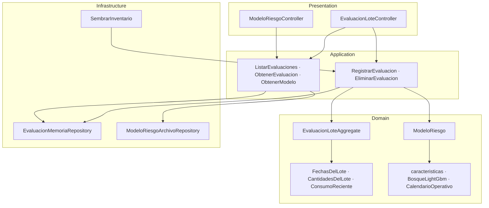

# Contexto: Predicción de vencimiento

## 1. Descripción general

Dice qué lotes perecederos de la despensa tienen riesgo de vencer antes de
terminarse, para que se usen primero. Recibe los datos de un lote en una
fecha de revisión, calcula sus variables, ejecuta el modelo LightGBM y guarda
la respuesta junto con la de la regla simple que sirve de línea base.

### Responsabilidades

- Cargar el modelo entrenado y su calendario al arrancar, y negarse a arrancar
  si no coinciden con lo que este código calcula.
- Validar una revisión de lote: forma (DTO) y reglas de negocio (objetos de
  valor).
- Calcular las 18 variables y la probabilidad, igual que en el entrenamiento.
- Guardar una evaluación por lote, la más reciente, con la predicción
  congelada y la versión del modelo.
- Listar, filtrar y paginar evaluaciones en el servidor.

### Reglas de negocio

1. Solo se evalúan insumos del catálogo con el que se entrenó el modelo.
2. El vencimiento es posterior al ingreso, y la revisión cae entre los dos. Un
   lote ya vencido no se evalúa: lo que queda es merma, no riesgo.
3. No puede quedar más de lo que se compró, y tiene que quedar algo.
4. El consumo de 7 días es obligatorio; el de 28 días puede faltar.
5. Las fechas tienen que caer dentro del calendario cargado (2025–2027).
6. `alto` es probabilidad ≥ umbral (la decisión del modelo); `vigilar`, la
   mitad del umbral o más; `bajo`, el resto.
7. Revisar de nuevo el mismo lote reemplaza su evaluación anterior.

## 2. Arquitectura

## 3. Flujo de una evaluación

1. `POST /evaluacion-lote` → `ValidationPipe` valida la forma del DTO.
2. `RegistrarEvaluacionHandler` busca el insumo en el catálogo del modelo.
3. Los objetos de valor validan las reglas que cruzan campos.
4. Se comprueba que las fechas caen dentro del calendario.
5. `ModeloRiesgo.predecir` construye las variables y evalúa los árboles.
6. Se crea el agregado con la predicción congelada y se guarda (reemplaza la
   del mismo lote).
7. El controlador devuelve el DTO plano; si algo falló, el filtro global
   escribe `{ codigo, tipo, mensaje, timestamp }`.

## 4. Puertos

| Token | Interfaz | Implementación |
|---|---|---|
| `IEvaluacionReadRepository` | `findById`, `findAll` | `EvaluacionMemoriaRepository` |
| `IEvaluacionWriteRepository` | `save`, `delete` | `EvaluacionMemoriaRepository` |
| `IModeloRiesgoRepository` | `obtener` | `ModeloRiesgoArchivoRepository` |
